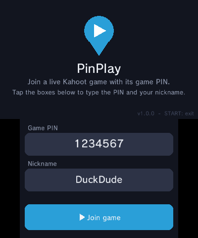
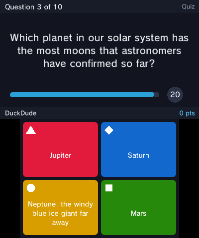
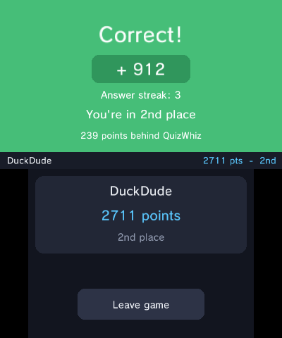
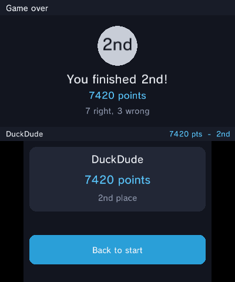
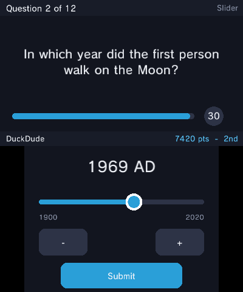
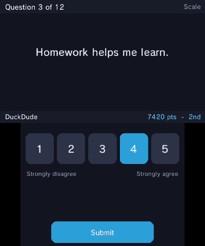
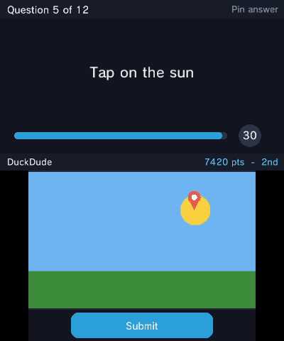
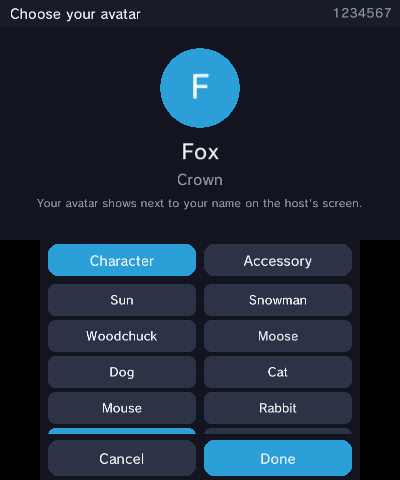

# PinPlay

Join live Kahoot! games from a Nintendo 3DS. Type the game PIN and a nickname, see the answer shapes on the touch screen, tap your answer, and get your points and rank, all over the 3DS's own internet connection, with no PC or relay in between.

| Home | Question | Result | Final rank |
|---|---|---|---|
|  |  |  |  |

| Slider | Scale | Pin on a picture | Avatar |
|---|---|---|---|
|  |  |  |  |

Works on the old 3DS and the New 3DS.

## Install

Download `PinPlay.cia` from the [latest release](../../releases/latest) and install it with FBI, or use `PinPlay.3dsx` with the Homebrew Launcher.

## What it can do

- Join by PIN with the 3DS keyboard (your last nickname is remembered)
- Quiz, true or false, and poll questions: tap the coloured tile that matches the host's screen
- Type-answer, word-cloud, brainstorm and open-ended questions through the keyboard (several answers where the question allows it)
- Pick-several and put-in-order questions
- Sliders (drag, the - and + buttons or the D-pad), scale and 0-10 rating questions
- Pin questions: the question's picture on the touch screen, tap where your pin goes
- Slides show their text; there's nothing to answer
- Change your avatar in the lobby when the host turns characters on (Kahoot's free characters and accessories, picked by name)
- The end-of-game rating form when the host asks for feedback
- Join a game that's already running and the current question shows up, ready to answer, like on kahoot.it
- Shows the question and answer text when the host sends them to players' devices
- Correct or incorrect, points, answer streak, your place, and how far behind the next player you are
- Final place, score and right/wrong count at the end
- Two-step join, host-generated nicknames, team mode (as a team of one)
- Wrong PIN, nickname already taken, locked games, being removed, and the game ending all get a clear screen
- Gets back into the game by itself if the connection drops for a moment

Kahoot's special game modes (paint wars, submarines and the like) show a "can't be played here" screen; you stay in the game for the next question. Self-paced challenges (PINs starting with 0) and games that require a Kahoot sign-in aren't supported.

PinPlay is one player on one console. It has no bots, no multiple joins and nothing that reveals or picks answers for you.

## How it works

The 3DS's built-in TLS is too old for kahoot.it, so PinPlay brings its own: mbedTLS from devkitPro's portlibs, with the needed root certificates in `romfs/cacert.pem`. It joins the same way the kahoot.it web page does:

1. `GET https://kahoot.it/reserve/session/<PIN>/` returns a session token header and a small JavaScript "challenge".
2. The challenge is a quoted message plus an arithmetic offset. PinPlay evaluates the offset with a tiny expression parser (no JS engine), decodes the message, and XORs it with the token to get the session id.
3. A secure websocket to `wss://kahoot.it/cometd/<PIN>/<session>` carries CometD/Bayeux messages: handshake, connect, login, then the game's messages (question start, time up, result, ranking, and a ping the player must answer).

The code is in `source/`: `tls.c` (mbedTLS sockets), `ws.c` (websocket), `json.c`, `kahoot.c` (the protocol on its own thread), `main.c` (the screens), `ui.c` (drawing, from N3V Player), `fetch.c` (background downloads of question pictures and the avatar list; PNG through libpng, JPEG through [stb_image](https://github.com/nothings/stb), public domain).

## Building

Needs devkitPro with libctru, citro2d/citro3d and the 3ds-mbedtls and 3ds-libpng portlibs, plus `makerom` and `bannertool` (set `CTRTOOLS` to their folder).

```sh
./build.sh            # dist/PinPlay.cia and dist/PinPlay.3dsx
./build.sh shots      # draws every screen from made-up data, saves screenshots to sdmc:/pinplay_shots
./build.sh solvetest  # checks the challenge solver against sdmc:/pinplay_solve.txt, then downloads the avatar list and a picture
./build.sh autojoin   # joins the game in sdmc:/pinplay_test.txt (PIN, nickname) and plays by itself, for testing
```

`tools/kprobe.py PIN` checks the join steps from a PC without joining the game. PinPlay writes a log of every message to `sdmc:/3ds/pinplay/log.txt`.

## Note

PinPlay is an unofficial app and is not made, endorsed or supported by Kahoot! ASA. "Kahoot!" is a trademark of Kahoot! ASA. PinPlay uses its own name and icon.

MIT licence.
